# Relacionamentos do FIT TRACK

Modelo da versão corrigida: 22 tabelas e 187 atributos no `schema.sql`. O dicionário completo do TG apresenta tipos, restrições e significado. As chaves abaixo refletem referências físicas; autorização por perfil e vínculo é verificada também pela API.

```mermaid
erDiagram
    usuarios ||--o{ sessoes : "usuario_id"
    usuarios ||--o| perfis_alunos : "usuario_id"
    usuarios ||--o| perfis_personais : "usuario_id"
    usuarios ||--o{ vinculos_aluno_personal : "aluno_id"
    usuarios ||--o{ vinculos_aluno_personal : "personal_id"
    usuarios ||--o{ treinos : "criador_id"
    treinos ||--o{ treino_exercicios : "treino_id"
    treinos ||--o{ atribuicoes_treino : "treino_id"
    usuarios ||--o{ atribuicoes_treino : "aluno_id"
    usuarios ||--o{ atribuicoes_treino : "personal_id"
    treinos ||--o{ execucoes_treino : "treino_id"
    usuarios ||--o{ execucoes_treino : "aluno_id"
    usuarios ||--o{ registros_nutricao : "aluno_id"
    usuarios ||--o{ mensagens_chat : "remetente_id"
    usuarios ||--o{ mensagens_chat : "destinatario_id"
    usuarios ||--o{ tokens_recuperacao_senha : "usuario_id"
    usuarios ||--o{ auditoria_operacoes : "usuario_id"
    treinos ||--o{ feedbacks_treino : "treino_id"
    usuarios ||--o{ feedbacks_treino : "aluno_id"
    usuarios ||--o{ feedbacks_treino : "personal_id"
    execucoes_treino ||--o{ feedbacks_treino : "execucao_id"
    usuarios ||--o{ historico_biometria : "aluno_id"
    exercicios_catalogo ||--o{ exercicios_busca : "exercicio_id"
    alimentos_taco ||--o{ vinculos_taco_pof : "taco_id"
    medidas_pof ||--o{ vinculos_taco_pof : "pof_id"
    usuarios ||--o{ vinculos_taco_pof : "responsavel_id"
    usuarios ||--o{ sugestoes_ia : "aluno_id"
    usuarios ||--o{ sugestoes_ia : "criador_id"
    treinos ||--o{ sugestoes_ia : "treino_id"
    usuarios ||--o{ sugestoes_ia : "enviado_personal_id"
    usuarios ||--o| validacoes_profissionais : "usuario_id"
```

## Entidades e atributos

| Tabela | Campos |
|---|---|
| usuarios | `id`, `nome`, `cpf`, `email`, `senha_hash`, `tipo`, `status`, `tema`, `notificacoes`, `criado_em`, `atualizado_em` |
| sessoes | `token`, `usuario_id`, `criado_em`, `expira_em` |
| perfis_alunos | `id`, `usuario_id`, `peso_kg`, `altura_cm`, `idade`, `meta_treinos_semana`, `meta_agua_ml`, `meta_calorias_kcal`, `meta_proteinas_g`, `meta_carboidratos_g`, `meta_gorduras_g`, `objetivo`, `criado_em`, `atualizado_em`, `data_nascimento`, `sexo_metabolico`, `fator_atividade` |
| perfis_personais | `id`, `usuario_id`, `cref`, `area_formacao`, `atuacao_principal`, `status_cref`, `criado_em`, `atualizado_em` |
| vinculos_aluno_personal | `id`, `aluno_id`, `personal_id`, `status`, `criado_em`, `atualizado_em` |
| treinos | `id`, `criador_id`, `titulo`, `descricao`, `nivel`, `tempo_estimado_min`, `cor_tema`, `e_modelo`, `criado_em`, `atualizado_em` |
| treino_exercicios | `id`, `treino_id`, `ordem`, `exercise_id`, `nome`, `grupo_muscular`, `series_padrao`, `reps_padrao`, `descanso_padrao`, `carga_padrao`, `gif_url`, `notas` |
| atribuicoes_treino | `id`, `treino_id`, `aluno_id`, `personal_id`, `dias_semana`, `ativo`, `atribuido_em` |
| execucoes_treino | `id`, `treino_id`, `aluno_id`, `duracao_segundos`, `concluido_em`, `series_executadas` |
| registros_nutricao | `id`, `aluno_id`, `data`, `agua_ml`, `calorias_consumidas`, `proteinas_g`, `carboidratos_g`, `gorduras_g`, `refeicoes`, `nutrientes_totais` |
| mensagens_chat | `id`, `remetente_id`, `destinatario_id`, `tipo`, `texto`, `video_url`, `enviado_em`, `lido` |
| tokens_recuperacao_senha | `id`, `usuario_id`, `token_hash`, `expira_em`, `usado`, `criado_em` |
| auditoria_operacoes | `id`, `usuario_id`, `operacao`, `detalhes`, `ip`, `criado_em` |
| feedbacks_treino | `id`, `treino_id`, `aluno_id`, `personal_id`, `texto`, `video_url`, `visualizado_pelo_personal`, `resposta_personal`, `respondido_em`, `criado_em`, `atualizado_em`, `execucao_id`, `nota_execucao`, `comentario_aluno` |
| historico_biometria | `id`, `aluno_id`, `peso_kg`, `altura_cm`, `objetivo`, `registrado_em` |
| exercicios_catalogo | `id`, `nome`, `forca`, `nivel`, `mecanica`, `equipamento`, `categoria`, `musculos_primarios`, `musculos_secundarios`, `instrucoes`, `imagens_caminhos`, `versao_origem`, `atualizado_em` |
| exercicios_busca | `termo`, `exercicio_id` |
| alimentos_taco | `id`, `nome`, `busca`, `base`, `preparo`, `categoria`, `nutrientes_100g`, `qualificadores`, `versao` |
| medidas_pof | `id`, `codigo_alimento`, `nome_alimento`, `codigo_preparo`, `preparo`, `nome`, `busca`, `gramas`, `fonte`, `original`, `versao` |
| vinculos_taco_pof | `taco_id`, `pof_id`, `ativo`, `criterio`, `evidencia`, `responsavel_id`, `criado_em` |
| sugestoes_ia | `id`, `aluno_id`, `criador_id`, `treino`, `origem`, `treino_id`, `enviado_personal_id`, `criado_em` |
| validacoes_profissionais | `usuario_id`, `estado`, `tentativas`, `proxima_tentativa`, `bloqueado_ate`, `ultimo_erro` |

## Integridade e dados legados

- Um vínculo ativo por aluno é protegido por índice único parcial; o par aluno/personal também é único.
- `perfis_alunos` acrescenta nascimento, parâmetro da equação e fator de atividade. A idade é derivada do nascimento; ausência em conta legada exige completar o perfil e não gera biometria fictícia.
- `sugestoes_ia` preserva o JSON validado, origem mock/Gemini, dono, criador, ficha salva e destinatário. Salvar repetidamente a mesma sugestão reaproveita a ficha.
- `validacoes_profissionais` mantém estado, tentativas, próxima execução e prazo de processamento. A migração inclui os profissionais pendentes legados; o worker não aprova por demonstração.
- `exercise_id` não possui FK ao catálogo para preservar exercícios manuais e snapshots de fichas.
- Atribuições próprias de IA podem ter `personal_id` nulo e são preservadas ao encerrar o acompanhamento profissional.
- `registros_nutricao` é único por aluno/data. Refeições, composição e totais parciais são snapshots JSONB; água é acumulada em mililitros.
- TACO e POF têm identificadores independentes. A conversão só usa massa de correspondência confirmada, com critério e evidência.
- Mídias não são binários no SQL; ficam referenciadas por caminhos ou URLs. A política do armazenamento deve proteger os vídeos conforme a implantação.
- Alterações HTTP e auditoria compartilham transação; a homologação de concorrência e migração em PostgreSQL real permanece necessária.
